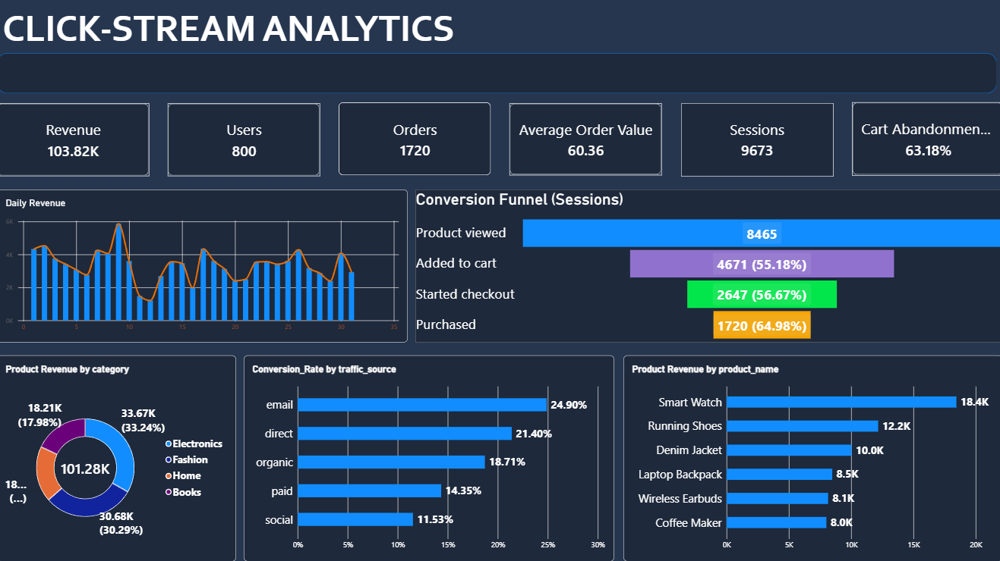

# ShopEasy: Centralized User Interaction & Clickstream Analytics

An end-to-end data engineering and analytics project that captures every click and interaction in an e-commerce app, stores it as structured events, and turns it into dashboards on conversion, cart abandonment, product performance and search behaviour.



## What it does

- Tracks every button click and interaction: user ID, session ID, button name, page name, interaction type, timestamp, feature name and flexible event properties.
- Captures business events (product view, add to cart, checkout, purchase, search, coupon) with product and order details.
- Serves analytics that answer: Where do customers drop off? Which products are viewed but not bought? Which traffic sources convert best? What do people search for but not find?

## Architecture

```
Demo shop (HTML/JS tracker)
        │  batched JSON events
        ▼
FastAPI collector  ──►  PostgreSQL  raw_events (JSONB properties)
                              │
              ┌───────────────┴────────────────┐
              ▼                                ▼
   SQL reporting views                 JSONL export (batch)
 (sessions, items, events)                     ▼
              │                      Databricks (PySpark)
              ▼                      bronze → silver → gold
   Power BI report
```

## Tech stack

| Layer | Technology |
|---|---|
| Event tracking | JavaScript (browser tracker), event schema with JSONB properties |
| Ingestion API | Python, FastAPI, Pydantic, psycopg2 (idempotent inserts on `event_id`) |
| Storage | PostgreSQL |
| Transformation | SQL views, PySpark on Databricks Free Edition (medallion: bronze, silver, gold) |
| Data generation | Python simulator (about [N]k events over 30 days) |
| Dashboards | Power BI (star schema, DAX) |


## Future improvements

- Streaming ingestion (Kafka or Event Hubs) with Structured Streaming
- Data quality checks and a quarantine table
- Orchestration with Databricks Jobs or Airflow
- Purchase-propensity model with MLflow

## Author

Renish G · 
